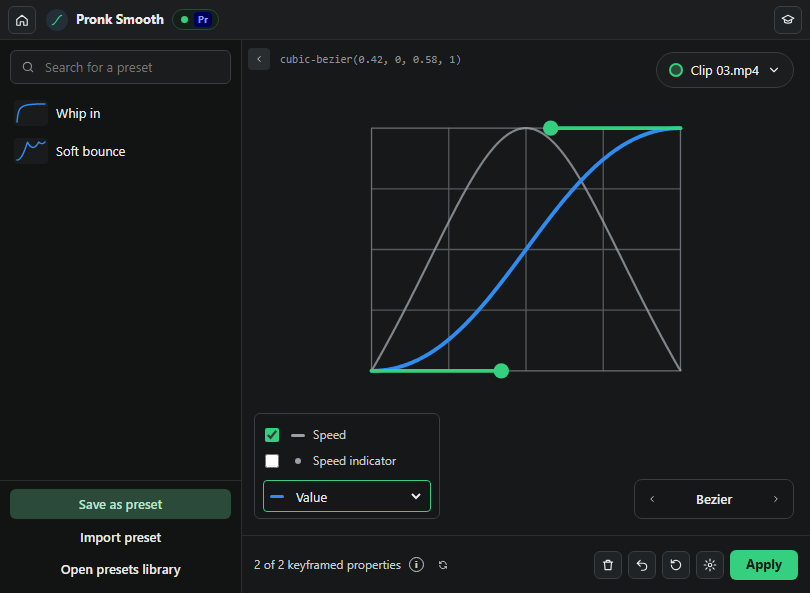

# Premiere Smooth Curve

Custom easing curves for Premiere Pro keyframes, in a dockable panel. Free and open source (MIT).



## Features

- Draw your own ease with a Bezier curve editor (drag the green handles, hold Shift to flatten a handle), or switch to **Elastic**, **Bounce** or **Spring** curves with sliders.
- Works on any keyframed number: Position, Scale, Rotation, Opacity, Anchor Point and effect parameters.
- Pick which keyframed properties of the selected clip(s) to smooth from the menu at the top right.
- **Presets:** save, search, export and import your own, plus a built-in library (Ease In Out, Expo, Back/overshoot, Whip, Slow-mo middle, Elastic, Bounce, Spring...).
- **Speed** graph view and speed indicator dots, like the After Effects graph editor.
- Re-apply as often as you like: your original keyframes are remembered as anchors. **Undo** reverts the last apply, the bin icon removes the smoothing.
- Settings: keyframe density (every frame or every 2, 3 or 4 frames) and apply to all keyframe pairs or only the pair under the playhead.

The panel docks inside Premiere like any built-in panel (drag its tab into any frame) and reflows down to about 360 px wide.

## Install

**Requirements:** Premiere Pro 2022 (22.0) or newer on Windows or macOS.

1. Download the latest ZIP from [Releases](../../releases/latest) (or **Code > Download ZIP**) and unzip it.
2. Run the installer:
   - **Windows:** double-click `install.bat`.
   - **macOS:** open Terminal in the folder and run `sh install.sh`.
3. Restart Premiere Pro and open **Window > Extensions > Premiere Smooth Curve**.

The installer copies the panel to your user's CEP extensions folder and turns on `PlayerDebugMode`, which Premiere needs to load unsigned panels.

<details><summary>Manual install</summary>

- Copy the folder (without `tests` and `docs`) to
  - Windows: `%APPDATA%\Adobe\CEP\extensions\com.pronk.smooth`
  - macOS: `~/Library/Application Support/Adobe/CEP/extensions/com.pronk.smooth`
- Enable unsigned panels:
  - Windows: `reg add HKCU\Software\Adobe\CSXS.12 /v PlayerDebugMode /t REG_SZ /d 1 /f` (repeat for CSXS.11)
  - macOS: `defaults write com.adobe.CSXS.12 PlayerDebugMode 1` (repeat for CSXS.11)
</details>

## Use

1. Add two or more keyframes to a property of a clip (for example Scale 100 -> 150).
2. Select the clip in the timeline.
3. Shape the curve or click a preset, then press **Apply** (or Ctrl+Enter).

## How it works

Premiere's scripting API cannot set keyframe Bezier handles, so the panel bakes the curve: between each pair of your keyframes it adds one linear keyframe per frame that follows the curve exactly. Your two original keyframes stay as anchors, so the result can be changed or removed later.

## Development

Plain HTML/CSS/JS (CEP) with an ExtendScript host (`jsx/host.jsx`); no build step. Tests run in Node:

```
node tests/host.test.js
```

`tests/preview.html` opens the panel in a normal browser with a mocked Premiere connection.

## License

MIT. Made by [Pronk Production](https://github.com/osamarehman01-code).
